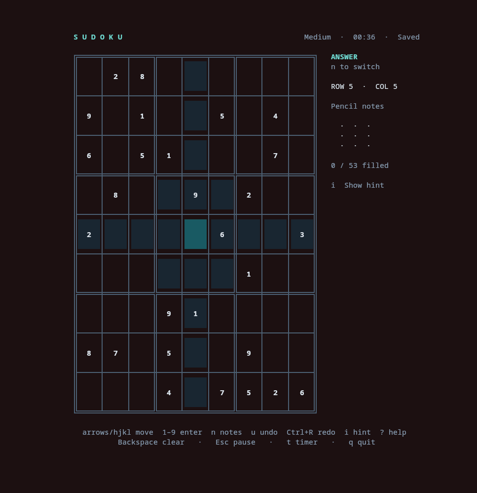
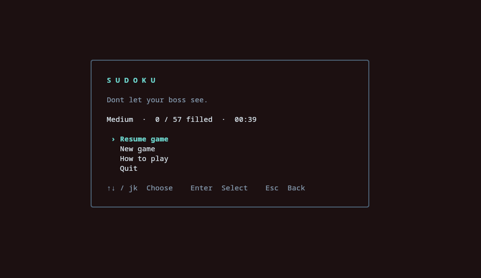
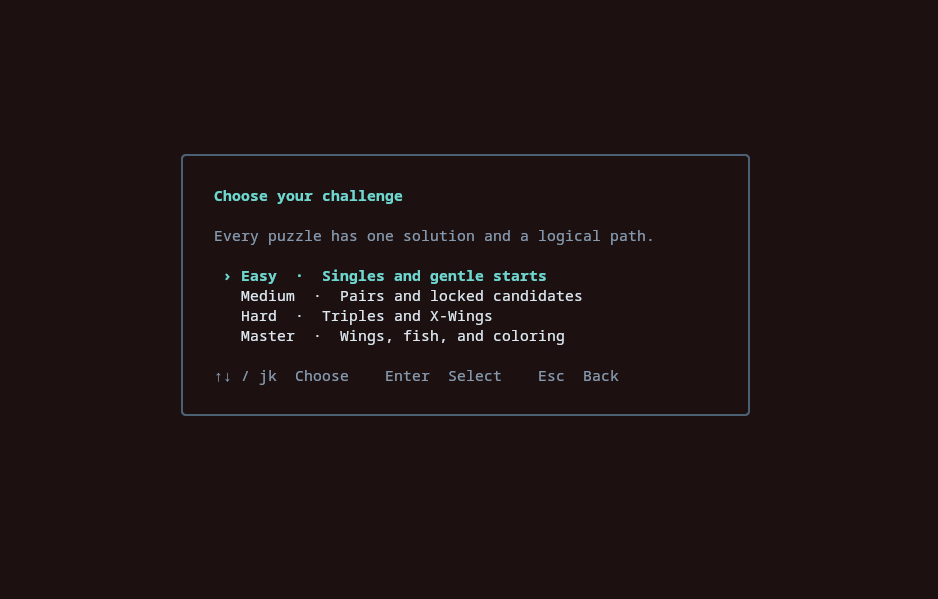

# Sudoku

[](https://github.com/pmck91/sudoku-term/actions/workflows/ci.yml?query=branch%3Amain+event%3Apush)
[](https://github.com/pmck91/sudoku-term/releases/latest)

Terminal Sudoku with four difficulties, pencil notes, hints, undo/redo, and automatic saving.
Linux only. Requires a terminal at least **80 columns × 24 rows**; full pencil marks appear at **80×42**.



<details>
<summary>Menu screenshots</summary>





</details>

## Download and run

Download the Linux **amd64** or **arm64** archive from the
[latest release](https://github.com/pmck91/sudoku-term/releases/latest), extract it, and run:

```sh
./sudoku
```

Release binaries do not require Go. Playing and generating puzzles work offline.

## Build from source

Requires **Go 1.26 or newer** and Make.

```sh
git clone https://github.com/pmck91/sudoku-term.git
cd sudoku-term
make build
./sudoku
```

To run directly from source: `go run ./cmd/sudoku`.
Set `NO_COLOR=1` to disable colors.

## Controls

| Key | Action |
| --- | --- |
| Arrows / `h j k l` | Move |
| `1`–`9` | Enter an answer or toggle a note |
| `n` | Switch Answer / Notes mode |
| Backspace / Delete / `0` | Clear the cell |
| `u` / Ctrl+R | Undo / redo |
| `i` | Show a hint; Enter applies it, Esc dismisses it |
| `t` | Show / hide the timer |
| `?` | Help |
| Esc | Pause / return |
| `q` / Ctrl+C | Save and quit |

Wrong answers appear red. Correct answers remove matching notes from their peers.
Each cell update is saved, including undo/redo and applied hints. Choose **Resume game**
on startup to continue; only one game is kept.

Saves live at `$XDG_STATE_HOME/sudoku-term/game.json`, defaulting to
`~/.local/state/sudoku-term/game.json`.

## Development

```sh
make check                              # Formatting and vet
make test                               # Tests with race detection
python3 scripts/pty_smoke.py ./sudoku     # Terminal smoke test after building
```

- [Board generation](docs/generator.md)
- [Solver and difficulty grading](docs/solver.md)
- [Hints and candidate state](docs/hints.md)
- [Development and releases](docs/development.md)
