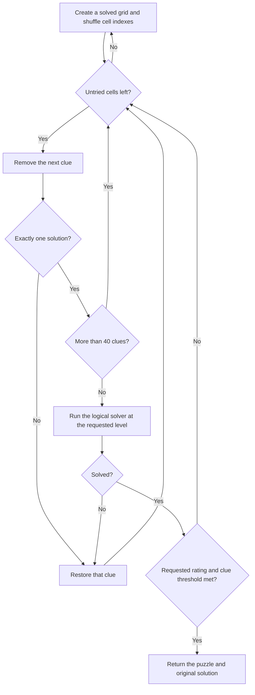

# Board generation

`Generate(ctx, level, rng)` creates a solved grid, removes clues, and checks the
result against the requested difficulty. It returns a `Puzzle` containing the
starting clues, full solution, and difficulty.

Source: [generate.go](../internal/puzzle/generate.go),
[grid.go](../internal/puzzle/grid.go), and [the logical solver](solver.md).

## 1. Create a solved grid

Start with an empty grid and use recursive backtracking:

1. Compute the allowed digits for every empty cell.
2. Select the cell with the fewest allowed digits. Ties use board order.
3. Try its allowed digits in random order.
4. Recurse after each placement. If a branch fails, try another digit.
5. Stop when all cells are filled.

A cell with no allowed digits ends that branch. Each recursive call receives a
copy of the grid, so failed branches do not change their parent's grid.

Choosing the most constrained cell reduces the number of branches to explore.
Random digit order produces different completed grids. The caller supplies the
random number generator, which lets tests use fixed seeds.

## 2. Remove clues

Keep the full solution and work on a copy. Shuffle the 81 cell indexes, then try
removing one clue at a time.

After each removal:

1. Call `CountSolutions(ctx, grid, 2)`. Keep the removal only if the count is one.
2. If more than 40 clues remain, continue removing clues without grading yet.
3. Otherwise, run `SolveLogic` with the requested level as its technique limit.
4. If the logical solver stalls, restore the clue.
5. If it solves the board at a lower rating, keep the removal and continue.
6. Return once the solver's rating matches the requested level. Easy also
   requires **34 or fewer clues**.

The uniqueness check stops after two solutions because that is enough to reject
a removal. See [solution counting](solver.md#backtracking-and-solution-counting).

If all cell indexes have been tried without a match, discard this attempt and
start with another solved grid.

## Difficulty and guarantees

Difficulty comes from the hardest technique used by the logical solver.
The 40-clue grading threshold and Easy's 34-clue limit control generation; they
do not define the four difficulty bands. The [solver's technique table](solver.md#technique-order)
defines those bands.

Every returned puzzle has one solution and a complete logical solving path
within the requested level. Generation returns the first match it finds.
It does not attempt uniform random sampling, rotational symmetry, or the
smallest possible clue set.

## Cancellation and game replacement

Generation has no fixed timeout, attempt limit, or puzzle-bank fallback.
It keeps searching until it finds a match or the context is canceled.
The outer search loop, recursive searches, and logical solving loop check the context.

The TUI runs generation in a background command. Esc cancels its context, and
an attempt ID lets the UI ignore results from a canceled attempt. The existing
game remains current until the new puzzle has been generated and saved successfully.

## Verification

[`TestGenerateAndLogicalSoundness`](../internal/puzzle/puzzle_test.go) uses fixed
seeds at every level. It checks uniqueness, the claimed solution, the reported
rating, and whether a lower technique limit stalls. It also checks every logical
placement and elimination against the known solution.
