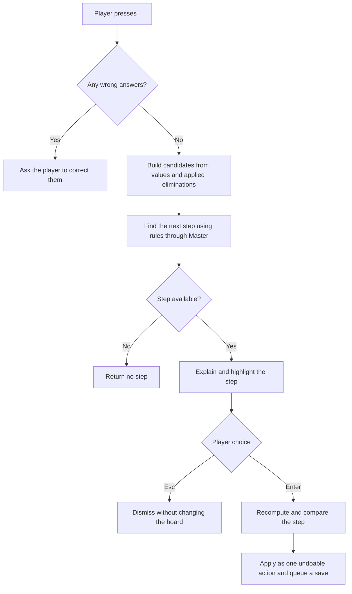

# Hints and candidate state

A hint is one logical solver step with an explanation and highlighted cells.
Requesting a hint leaves the board unchanged. Enter applies it; Esc dismisses it.

Source: [game.go](../internal/game/game.go),
[solver.go](../internal/puzzle/solver.go), and
[the TUI event loop](../internal/tui/model.go).

## Three kinds of cell state

| State | Purpose |
| --- | --- |
| `Value` | The placed answer, or zero for an empty cell |
| `Notes` | Pencil marks entered by the player or updated by an applied hint |
| `Eliminated` | Candidates ruled out by previously applied logical hints |

Notes are annotations. They can be incomplete or incorrect, so the solver
computes its own candidates from placed values and `Eliminated` masks.

For each empty cell:

```text
candidates = digits 1–9
             minus digits placed in peers
             minus previously applied logical eliminations
```

Keeping `Eliminated` separate from notes lets the player edit notes freely and
lets the next hint continue after an applied elimination.

## Finding a hint



`Game.Hint` first compares placed answers with the stored solution. Any wrong
answer blocks hints, including answers that do not yet cause a duplicate in a
row, column, or box. This prevents deductions based on incorrect assumptions.

It then builds `Logic` from the current values and elimination masks and calls
`Next(Master)`. The [solver's fixed rule order](solver.md#technique-order)
selects the first useful step anywhere on the board. The cursor and selected
game difficulty do not limit this search.

The stored solution is used for mistake checking. Logical deductions come from
the candidate masks. If no supported rule produces a step, `Hint` returns nil;
a completed board also produces no step.

## Applying a hint

`ApplyHint` calls `Hint` again and compares the complete new step with the
displayed step using `reflect.DeepEqual`. A mismatch rejects the action and
asks for a fresh hint. The solver's deterministic ordering makes this comparison
stable.

### Placement

A step with a nonzero `Digit` goes through the normal answer-entry path:

1. Clear stored logical eliminations across the board.
2. Place the digit and clear that cell's notes.
3. For a correct answer, remove matching notes from its peers.
4. Record all changed cells as one undoable action.

### Candidate elimination

For each affected cell:

1. If its notes are empty, initialize them from its current logical candidates.
2. Remove the step's digits from the notes.
3. Add those digits to the cell's `Eliminated` mask.

Existing nonempty notes retain the player's other annotations. The action
records both visible note changes and logical eliminations. The next request
subtracts those eliminations, so it can advance to another deduction.

For example, suppose a cell's computed candidates are `{2, 5, 8}` and a hint
eliminates 5. An empty notes set becomes `{2, 8}`, and `Eliminated` records 5.
If the player already had notes `{2, 5}`, those notes become `{2}`.

## Edits, undo, and saving

Changing an answer or clearing a placed answer resets every `Eliminated` mask.
This rebuilds the basis for subsequent deductions after the board changes.
Re-entering the same answer is a no-op. Editing or clearing notes alone keeps
logical eliminations intact.

Undo and redo restore recorded cell states directly, including values, notes,
and eliminations. A new action clears the redo history.

The TUI queues a save after a changed hint is applied. The save contains both
the cell state and undo/redo history, so applied eliminations survive a restart.
Viewing or dismissing a hint creates no cell update or undo entry. The timer
pauses while the hint is displayed.

## Verification

[`game_test.go`](../internal/game/game_test.go) checks placement hints,
elimination state, advancing beyond an applied elimination, undo/redo, and
resetting eliminations after an answer changes.
[`model_test.go`](../internal/tui/model_test.go) checks showing and applying
hints through the UI, saving, and timer behavior.
