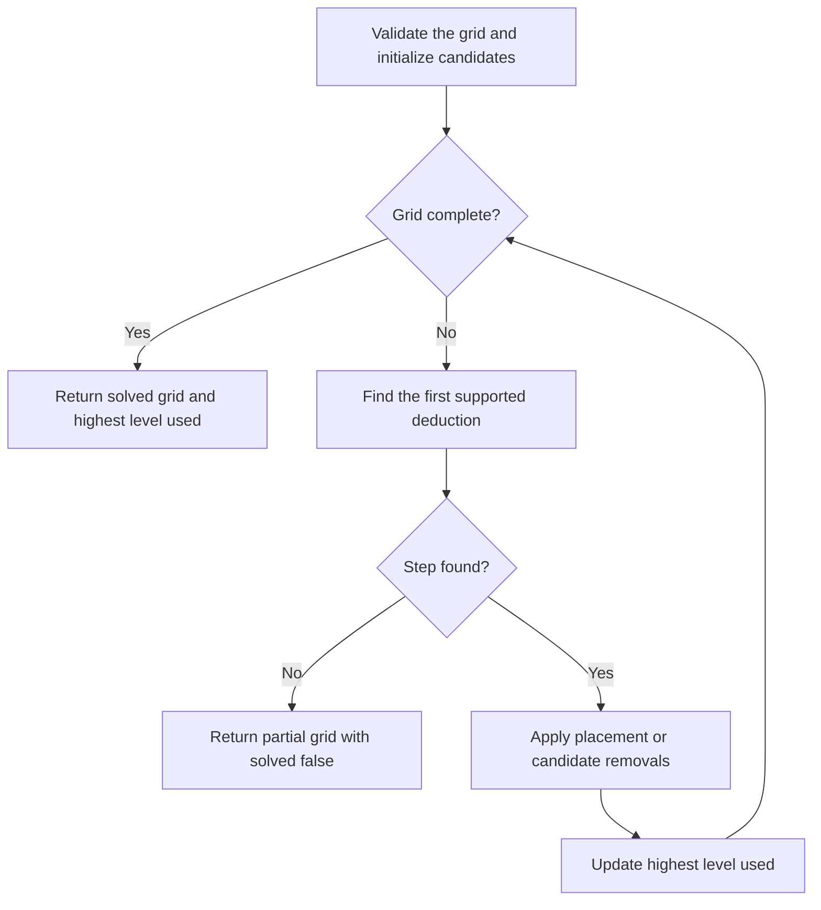

# Solver and difficulty grading

The engine has two solving paths:

| Entry point | Job | Method |
| --- | --- | --- |
| `CountSolutions` | Check uniqueness during generation and save loading | Backtracking |
| `SolveLogic` | Verify a logical solving path and assign difficulty | Repeated deductions |

The generator also uses `randomSolution`, a randomized backtracking search, to
create completed grids. Hints use one deduction from the logical solver at a time.

Source: [grid.go](../internal/puzzle/grid.go) and
[solver.go](../internal/puzzle/solver.go).

## Board and candidate representation

- `Grid` is an array of 81 digits in row order. Index `row*9 + column` addresses
  a cell; rows and columns are zero-based internally. Zero means empty.
- `Mask` is a nine-bit set stored in a `uint16`. Digit `d` uses bit `d-1`.
- A **unit** is a row, column, or 3×3 box. The engine precomputes all 27 units.
- A cell's **peers** are its 20 distinct neighbors sharing a unit.
- Two cells **see** each other when they share a row, column, or box.

An empty cell starts with digits 1–9 as candidates. Remove every digit already
placed in its peers. Filled cells have no candidate mask.

For example, `{1, 4, 7}` is represented by `Bit(1) | Bit(4) | Bit(7)`.
Counting set bits gives the candidate count; clearing bits removes candidates.

## Backtracking and solution counting

`CountSolutions(ctx, grid, limit)` first rejects grids with invalid digits or
duplicate placed digits in a unit. Its recursive search then:

1. Finds the empty cell with the fewest allowed digits.
2. Ends a branch if a cell has no allowed digits.
3. Tries the selected cell's allowed digits in ascending order.
4. Counts a solution when the grid is full.
5. Stops as soon as it reaches `limit` or exhausts the search.

Each call works on a grid copy and checks cancellation before exploring its branch.
The returned grid is the last solution found. Callers checking uniqueness pass
`limit = 2` and accept only a count of one.

`randomSolution` uses the same cell-selection rule, tries digits in random order,
and stops at its first solution. Backtracking can require exponential work in
the worst case; selecting the most constrained cell reduces branching.

## Logical solving loop

`Logic` stores the current grid and a candidate mask for each cell.
`NewLogic` computes masks from placed digits, then subtracts any supplied
logical eliminations. During grading, those supplied eliminations start empty.

`SolveLogic` calls `Logic.Next(max)` for one deduction, applies it, and repeats.
It checks cancellation on each iteration. An invalid input or a stalled search
returns `solved = false`; cancellation returns an error. A 4,096-step guard
returns an error if the loop fails to converge.

The candidate masks survive between steps. A placement removes its digit from
all peers; an elimination clears only the specified bits. Earlier deductions
remain available to later steps.

## Technique order

`Next` tries these rules in the listed order and returns the first useful step.
It skips rules above the supplied difficulty limit. A pattern must produce a
placement or at least one candidate removal to count as a step.

| Order | Technique | Level | Deduction |
| --- | --- | --- | --- |
| 1 | Naked single | Easy | A cell has one candidate; place it. |
| 2 | Hidden single | Easy | A digit has one possible cell in a unit; place it. |
| 3 | Locked candidates | Medium | A digit's positions in a box all share one line, or its positions in a line all share one box. Remove it elsewhere in that overlapping unit. |
| 4 | Naked pair | Medium | Two cells contain only the same two digits. Remove those digits from other cells in their unit. |
| 5 | Hidden pair | Medium | Two digits are confined to two cells in a unit. Remove other candidates from those cells. |
| 6 | Naked triple | Hard | Three cells' combined candidates contain three digits. Remove those digits from other cells in their unit. |
| 7 | Hidden triple | Hard | Three digits are confined to three cells in a unit. Remove other candidates from those cells. |
| 8 | X-Wing | Hard | A digit is restricted to the same two columns in two rows, or the reverse. Remove it elsewhere in those columns or rows. |
| 9 | XY-Wing | Master | A two-candidate pivot connects two wings that force a shared digit in one wing. Remove that digit from cells seeing both wings. |
| 10 | Swordfish | Master | Extend the X-Wing rule to three rows and three columns. |
| 11 | Simple coloring | Master | Use chains of linked candidate pairs to eliminate impossible candidates. |

Cells and units are scanned in fixed order. Subsets and fish use fixed-order
combinations. Given the same grid, candidate masks, and difficulty limit,
`Next` produces the same step.

### Pairs, triples, and fish

`subset(size, hidden)` handles pairs and triples. For naked subsets, it chooses
`size` cells whose candidate union contains exactly `size` digits. For hidden
subsets, it chooses `size` digits whose positions cover exactly `size` cells.

`fish(size)` handles X-Wing (`size = 2`) and Swordfish (`size = 3`). For one
digit, it chooses that many rows and requires their candidate positions to cover
exactly that many columns. Each chosen row must contain between two and `size`
positions. It also checks the pattern with rows and columns exchanged.

### XY-Wing example

A pivot has `{1, 2}`. Two of its peers have `{1, 3}` and `{2, 3}`.
If the pivot is 1, the first wing is 3. If the pivot is 2, the second wing is 3.
A cell that sees both wings therefore cannot contain 3.

### Simple coloring

For one digit, create a graph of candidate cells. Add an edge when a unit has
exactly two possible positions for that digit: exactly one end of the edge
must contain it.

Use breadth-first traversal to assign alternating colors to each connected
component. Then apply one of two rules:

- If two cells of the same color see each other, eliminate that color's
  candidates throughout the component.
- Otherwise, an outside cell that sees both colors cannot contain the digit.

Repeat for digits 1–9 until a useful elimination is found.

## Steps and ratings

Every deduction is a `Step` with:

| Field | Meaning |
| --- | --- |
| `Technique`, `Level`, `Explanation` | Rule name, difficulty, and explanation text |
| `Cells` | Cells forming the pattern, used for highlighting |
| `Cell`, `Digit` | Placement target and value; a nonzero `Digit` identifies a placement |
| `Removals` | Target cells and digit masks to eliminate |

The rating is the highest level encountered along this deterministic solving
path. Hard, for example, means the path used at least one Hard step and no
Master steps. These are the app's own difficulty bands; another solver may
find a different path or assign a different rating.

The [generator](generator.md) accepts only solved boards whose rating matches
the requested level. [Hints](hints.md) reuse the same `Step` values and rules.

## Verification

[`puzzle_test.go`](../internal/puzzle/puzzle_test.go) checks solution counts,
individual technique patterns and counterexamples, and generated puzzles at all
four levels. For generated puzzles, every placement must match the known
solution and every elimination must preserve that solution's digit.
